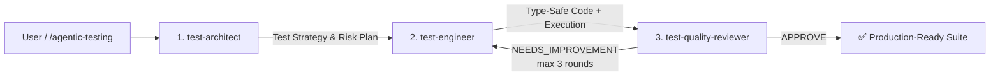

# 🧪 Agentic QA Architecture for TypeScript & JavaScript

A multi-agent Quality Engineering workflow and skill set designed for **Claude Code** (and compatible with `AGENTS.md` ecosystems). It orchestrates three specialized QA subagents to **design, implement, execute, and audit** strictly-typed automated tests across the TypeScript/JavaScript ecosystem.

---

## 🔄 How It Works

Instead of asking a single generic AI prompt to "write tests," this architecture enforces separation of concerns through a 3-stage pipeline with a built-in self-healing loop:



### The Subagent Roster

| Subagent | Role | Responsibilities | Permissions |
| :--- | :--- | :--- | :--- |
| **`test-architect`** | **Strategy & Design** | Inspects `package.json` & `tsconfig.json`, assesses risks, defines test pyramid layers, contract rules, and performance SLOs. Hands off a concrete implementation plan (no code). | **Read-Only** (`Read`, `Glob`, `Grep`, `Bash`) |
| **`test-engineer`** | **Implementation & Execution** | Generates strictly-typed tests, builders, and page/step objects. Runs `tsc --noEmit` and executes suites until green. | Read / Write / Bash |
| **`test-quality-reviewer`** | **Pre-Merge QA Audit** | Audits test code for flakiness (`waitForTimeout`, unawaited promises), weak assertions, missing edge cases, and `any` types. Issues `APPROVE` only when there are no Critical/High findings. | **Read-Only** (`Read`, `Glob`, `Grep`, `Bash` for verification only) |

---

## 🧰 Supported Ecosystem

The agents dynamically inspect your repository and adapt to the tools already installed:

- **Unit & Integration:** Vitest, Jest, Node Test Runner, Testing Library, MSW
- **E2E & UI:** Playwright, Cypress, CodeceptJS
- **API & Contract Testing:** Supertest, Playwright `APIRequestContext`, CodeceptJS (`REST` / `GraphQL` + `JSONResponse`), PactumJS, Pact, Zod, Joi, OpenAPI
- **Performance & Load:** k6 (TypeScript), Artillery, Autocannon, Lighthouse CI

---

## 🚀 Quick Start

### Option 1: Install in Your Current Project (Recommended for Teams)
Run this command in the root of your TypeScript/JavaScript repository to install the agents, the `/agentic-testing` skill, `AGENTS.md`, and `CLAUDE.md`. Existing `AGENTS.md`/`CLAUDE.md` files are never overwritten: the QA rules are appended to your `AGENTS.md` as a section delimited by `<!-- agentic-testing:start/end -->` markers (re-running the installer updates only that section), and an `@AGENTS.md` import is appended to your `CLAUDE.md` if it doesn't already have one:

```sh
curl -fsSL https://raw.githubusercontent.com/alfred-tester/agentic-testing/main/install.sh | sh
```

### Option 2: Install Globally (Available Across All Your Local Repos)
Install the subagents and skill into `~/.claude/` so you can invoke them in any project on your machine:

```sh
curl -fsSL https://raw.githubusercontent.com/alfred-tester/agentic-testing/main/install.sh | sh -s -- --global
```

### Option 3: GitHub Template Repository
Click **"Use this template"** at the top of this repository to bootstrap a new project with the complete QA orchestration structure pre-configured.

---

## 💻 Usage Examples

### 1. Run the Full 3-Stage Pipeline (`/agentic-testing`)
Use the custom skill inside Claude Code to plan, build, run, and audit a complete test suite:

```text
/agentic-testing src/modules/orders/
```

```text
/agentic-testing src/api/checkout.ts -- include API contract tests and a k6 smoke load test
```

### 2. Invoke Individual Subagents
You can also call each specialist independently depending on what you need:

- **Design a test strategy before coding:**
  > *"Use `test-architect` to analyze `src/services/payment.service.ts` and propose a unit, integration, and API contract testing plan."*
- **Generate and run tests directly:**
  > *"Use `test-engineer` to implement the missing edge cases for `tests/api/users.spec.ts` and run the suite until it passes."*
- **Audit changes before opening a Pull Request:**
  > *"Use `test-quality-reviewer` to audit my current `git diff` for flakiness, weak assertions, and TypeScript strictness."*

---

## 🛡️ Non-Negotiable Quality Standards Enforced

Every test suite generated or audited under this architecture adheres to five core rules:

1. **Strict TypeScript Discipline:** Zero `any`, `@ts-ignore`, or unsafe type assertions in test files and data factories.
2. **Zero Functional Flakiness:** Fixed delays (`setTimeout`, `page.waitForTimeout`, `I.wait`) are strictly prohibited in functional suites.
3. **Runtime Contract Validation:** API responses must be validated at runtime (Zod, Joi, Ajv, or CodeceptJS `JSONResponse`), not just trusted via compile-time interfaces.
4. **Explicit Performance Thresholds:** Load tests must enforce percentile latency SLOs (`p95`, `p99`) and error-rate limits.
5. **Known Source Bugs as Expected Failures:** When a test uncovers a real bug, it keeps asserting the correct behavior, is marked as an expected failure (`it.fails`, `test.failing`, `test.fail`) with a `FIXME(bug)` comment, and turns red automatically once the bug is fixed — so CI stays green without hiding the defect.

---

## 📁 Repository Structure

```text
.
├── AGENTS.md                          # Universal orchestration & QA standards
├── CLAUDE.md                          # Native Claude Code entry point
├── install.sh                         # One-line installer (local or --global)
├── README.md                          # Community documentation
└── .claude/
    ├── agents/
    │   ├── test-architect.md          # Role 1: Strategy & Architecture
    │   ├── test-engineer.md           # Role 2: Code Generation & Execution
    │   └── test-quality-reviewer.md   # Role 3: Read-Only Pre-Merge Auditor
    └── skills/
        └── agentic-testing/
            └── SKILL.md               # /agentic-testing pipeline orchestrator
```

---

## 🤝 Contributing

Contributions are welcome! Feel free to open an issue or submit a Pull Request to add framework-specific idioms, example outputs, or improvements to the agent prompts.

## 📄 License

MIT
