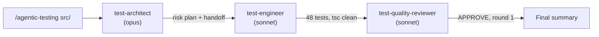

# Example: `/agentic-testing` on a small checkout module

This folder is the **real, unedited result** of running the pipeline once on a tiny TypeScript project with no tests. It shows what each agent produced, the test suite it generated, and how the pipeline handled a real bug and an ambiguous behavior.

```text
/agentic-testing src/
```

## The project under test

| File | What it does |
| :--- | :--- |
| [`src/pricing.ts`](src/pricing.ts) | `calculateTotals()`: subtotal, percent/fixed coupons, and shipping (free from 5000 cents) |
| [`src/orderService.ts`](src/orderService.ts) | `OrderService.placeOrder()`: coupon lookup, pricing and persistence through an injected repository, clock and ID generator |

> [!IMPORTANT]
> **A bug was planted on purpose** to see whether the pipeline finds it: the comment in `src/pricing.ts` says orders of *"5000 cents or more ship for free"*, but the code uses `>` instead of `>=`, so an order of exactly 5000 is charged 599 for shipping.

Stack: TypeScript 5 (`strict`, `noUncheckedIndexedAccess`) and Vitest 3. No other test tooling was installed beforehand.

## How the run went



| Phase | Agent | Output | Highlights |
| :--- | :--- | :--- | :--- |
| 1. Plan | `test-architect` | [01-architect-plan.md](pipeline/01-architect-plan.md) | Read-only analysis. Ranked the risks, chose unit + in-process integration layers (no API/E2E/perf: there is no HTTP layer or UI), spotted the `>` vs `>=` contradiction, and handed off a file-by-file plan. Wrote no files. |
| 2. Build | `test-engineer` | [02-engineer-report.md](pipeline/02-engineer-report.md) | Created typed factories, fakes and 48 tests. Ran `tsc --noEmit` and Vitest until green. Ran the bug tests **without** `it.fails` first to confirm they fail for the documented reason, then restored the marker. No production code touched. |
| 3. Audit | `test-quality-reviewer` | [03-reviewer-audit.md](pipeline/03-reviewer-audit.md) | Received the engineer's full report, re-ran the checks, cross-checked the bug against the source and approved with no Critical/High findings. |
| — | Orchestrator | [04-final-summary.md](pipeline/04-final-summary.md) | Executive summary for the user. |

**Run stats:** 1 review round · ~5 minutes · ~$0.73 USD (opus $0.23 for the architect, sonnet $0.51 for everything else).

## What it found

### ✅ The planted bug, as an expected failure

The engineer kept the assertion on the **correct** behavior, marked it as an expected failure and documented it, following the Known Source Bug protocol. The suite stays green, and the test turns red as soon as someone fixes `>` to `>=`, reminding them to remove the marker.

```ts
// FIXME(bug): src/pricing.ts:53 uses `>` but the documented contract is "5000 or more ships free".
// Expected shipping 0 / total 5000 at exactly 5000, got shipping 599 / total 5599. Severity: Medium.
it.fails('ships for free when the subtotal is exactly 5000', () => {
  expect(calculateTotals(itemsTotalling(5000))).toEqual({
    subtotal: 5000,
    discount: 0,
    shipping: 0,
    total: 5000,
  });
});
```

A second `it.fails` test covers the same boundary reached through a coupon (6000 minus a fixed 1000).

### ⚠️ An ambiguous behavior, flagged for a human decision

A coupon with a `NaN` value slips past the range checks and produces `NaN` totals. Because the spec doesn't say what should happen, the architect asked for a test that documents the current behavior with a `// NOTE:`. The reviewer pushed back (Medium): the test *"locks in behaviour that is very likely a defect"*, and it should become an `it.fails` + `FIXME(bug)` test if the product owner confirms it must throw. The final summary surfaces this as an open question instead of deciding silently.

### Other observations

The suite also documents, with `// NOTE:` comments, a few service quirks worth a product decision: a whitespace-only coupon code throws "not found", a failed order still consumes an ID, and the saved order keeps a reference to the caller's items array.

## Run it yourself

```sh
cd examples/demo-shop
npm install
npm run typecheck   # tsc --noEmit
npm test            # 48 passed (2 of them are expected failures)
```

To reproduce the whole pipeline, delete `tests/`, install the agents with the one-line installer from the [main README](../../README.md#-quick-start), open Claude Code in this folder and run `/agentic-testing src/`.

> [!NOTE]
> The agents are LLMs, so a new run won't produce identical files. Test names, file layout, number of tests and even severities vary between runs. In our runs, every one found the planted shipping bug; how strictly they treated ambiguous cases such as `NaN` coupons varied. The rules that don't vary are enforced by the prompts: no `any`, no sleeps, no production code edits, bugs kept as documented expected failures, and an explicit reviewer verdict.
